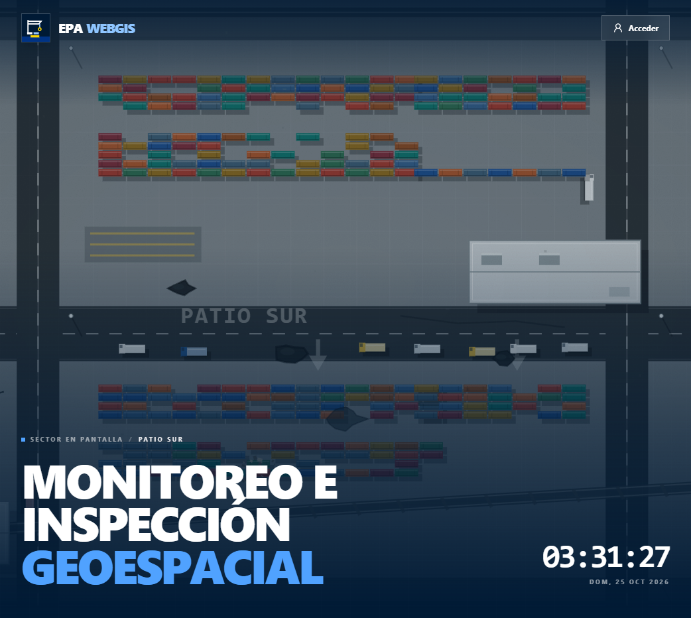
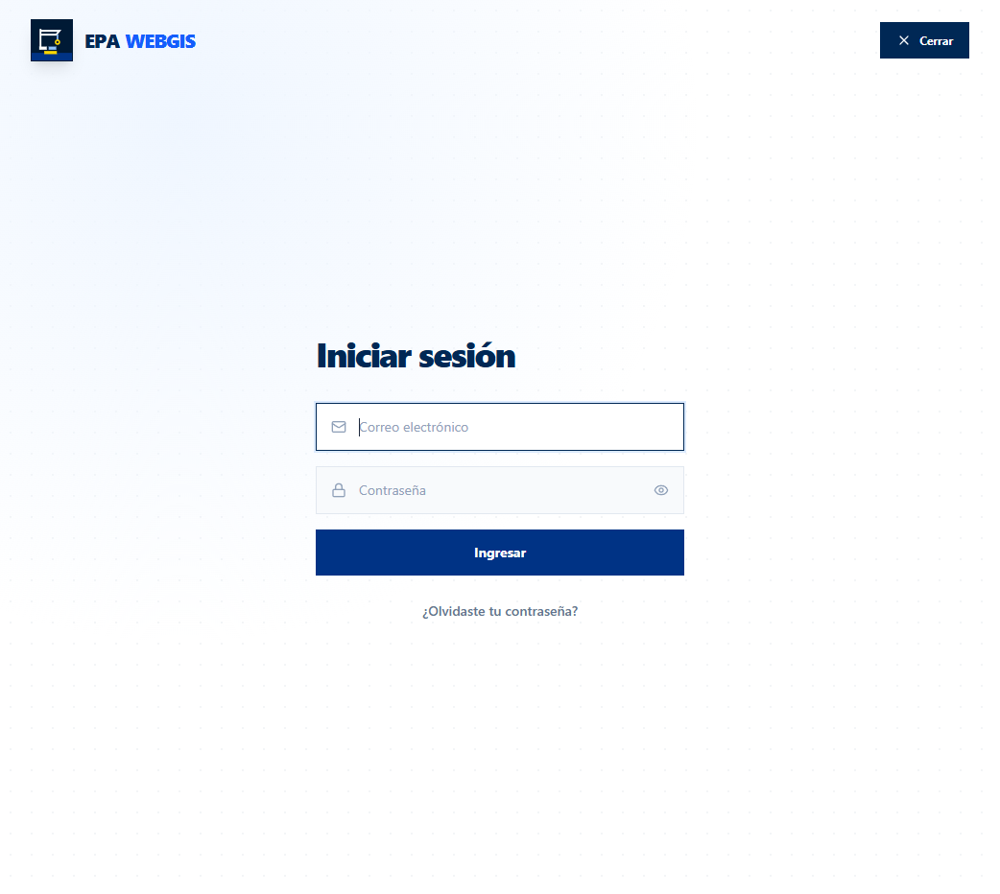
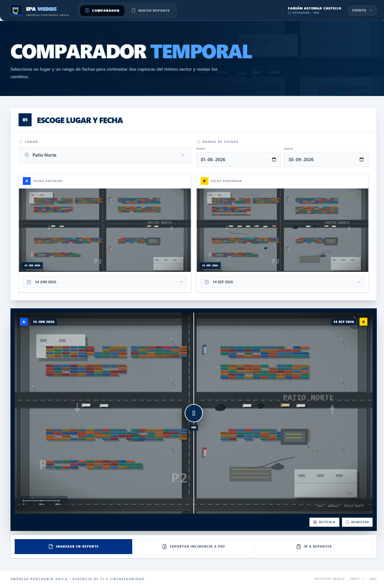

# EPA WebGIS · Frontend

Frontend del sistema **WebGIS de monitoreo e inspección geoespacial** para la
**Empresa Portuaria Arica (EPA)** y la **ZEAP**, integrado en la solución Aspire `WebGIS`.
Cubre tres artefactos de interfaz:

1. **Acceso institucional** con portal y carrusel de capturas aéreas.
2. **Comparador temporal tipo cortina** con selección de capturas A/B.
3. **Creación de reporte ejecutivo** con vista previa A4 y generación simulada de PDF.

La solución completa está compuesta por:

- `frontend/`: este proyecto React + Vite.
- `WebGIS.Server/`: API ASP.NET Core.
- `WebGIS.AppHost/`: orquestación Aspire que levanta ambos.

> Los tres artefactos funcionan con datos simulados. La API real todavía no está
> implementada; la capa de servicios ya contiene los contratos previstos para ASP.NET Core
> y PostgreSQL/PostGIS.

Guion corto para presentar los tres artefactos: [`docs/GUION-DEMOSTRACION.md`](docs/GUION-DEMOSTRACION.md).





---

## 1. Rutas

| Ruta | Artefacto | Requisito de referencia |
|---|---|---|
| `/login` | Portal + carrusel + acceso y recuperación simulada | RF-10 / CU-01 |
| `/comparador` | Selección de capturas y cortina deslizadora A/B | RF-06 / CU-05 |
| `/reportes/nuevo` | Asistente de reporte ejecutivo en 3 pasos | RF-09 / CU-08 |

Rutas auxiliares:

- `/` redirige a `/login`.
- Las rutas internas están protegidas por sesión simulada; sin sesión redirigen a `/login`.
- Cualquier ruta desconocida muestra una pantalla 404 con la identidad del prototipo.

## 2. Ejecución

### Desde Visual Studio / Aspire (recomendado)

1. Abrir `C:\Users\fabia\source\repos\WebGIS\WebGIS.slnx`.
2. Seleccionar `WebGIS.AppHost` como proyecto de inicio.
3. Ejecutar con `F5`.

Aspire levanta `WebGIS.Server` y el frontend Vite. La URL del frontend aparece en el
dashboard de Aspire. El proxy `/api` de Vite se encarga de llevar las futuras llamadas al
servidor ASP.NET Core.

> La primera vez, si no existe `frontend/node_modules`, ejecutar `npm install` dentro de
> `frontend`. En esta máquina ya quedó instalado.

También se puede iniciar desde la terminal:

```powershell
cd C:\Users\fabia\source\repos\WebGIS
dotnet run --project WebGIS.AppHost
```

### Solo el frontend

```powershell
cd C:\Users\fabia\source\repos\WebGIS\frontend
npm install
npm run dev
```

Abrir la URL que indique Vite (por defecto `http://localhost:5173`). En modo mock no se
necesita el backend. Si se levanta el servidor por separado, el proxy `/api` apunta por
defecto a `http://localhost:5328`.

Comandos disponibles:

```bash
npm run dev          # servidor de desarrollo Vite
npm run build        # verificación TypeScript + build de producción
npm run preview      # sirve el build
npm run lint         # ESLint
npm run mock:images  # regenera los ortomosaicos simulados en public/mock
```

Requisitos: Node.js `^20.19.0` o `>=22.13.0` (ver `package.json`).

### Acceso de demostración

No existe validación contra servidor. En `/login`:

1. Presionar **Acceder** en el extremo superior derecho.
2. El panel de acceso se desliza y ocupa toda la pantalla.
3. Ingresar cualquier correo válido y una contraseña de 4 o más caracteres.
4. Presionar **Ingresar**.

La sesión simulada usa el perfil **Operador**. El rol real y los permisos de RF-10 se
aplicarán cuando exista el backend. La recuperación de contraseña usa el código simulado
**482913**.

## 3. Stack

| Capa | Herramientas |
|---|---|
| UI | React 19 + TypeScript 5.9 |
| Build | Vite 8 |
| Estilos | Tailwind CSS 4 |
| Rutas | React Router 7 |
| Animación | Framer Motion 12 |
| Iconos | Lucide React |
| Carrusel | Embla Carousel + Autoplay |
| Alertas | SweetAlert2 + sweetalert2-react-content |
| Utilidades | clsx + tailwind-merge |

La selección de librerías sigue la línea del proyecto SISAC (referencia visual), sin reutilizar
su contenido, logos, textos ni identidad institucional.

## 4. Estructura

```text
WebGIS/
├─ frontend/                     # este proyecto React + Vite
├─ WebGIS.Server/                # API ASP.NET Core
├─ WebGIS.AppHost/               # orquestación Aspire
└─ WebGIS.slnx
```

Dentro de `frontend/`:

```text
├─ public/
│  ├─ favicon.svg
│  └─ mock/                     # 10 ortomosaicos SVG simulados (5 sectores × 2 fechas)
├─ scripts/
│  └─ generate-mock-aerials.mjs # generador reproducible de las imágenes
├─ docs/screenshots/            # capturas de los tres artefactos
├─ src/
│  ├─ components/
│  │  ├─ AppShell.tsx           # navbar + sesión + layout autenticado
│  │  ├─ Badges.tsx             # estados, severidades, categorías
│  │  ├─ Brand.tsx              # marca EPA WebGIS (SVG propio)
│  │  ├─ CurtainComparator.tsx  # cortina accesible (mouse/touch/teclado)
│  │  ├─ Modal.tsx
│  │  ├─ PageHeader.tsx         # cabecera con carrusel de fondo opcional
│  │  ├─ ProtectedRoute.tsx
│  │  └─ report/
│  │     ├─ GenerationModal.tsx # progreso y confirmación de generación
│  │     ├─ ReportPreview.tsx   # documento A4 imprimible
│  │     └─ ReportStepper.tsx
│  ├─ context/AuthContext.tsx
│  ├─ mocks/data.ts             # sectores, capturas, vuelos e incidencias
│  ├─ pages/
│  │  ├─ LoginPage.tsx
│  │  ├─ ComparatorPage.tsx
│  │  ├─ ReportCreatePage.tsx
│  │  └─ NotFoundPage.tsx
│  ├─ services/
│  │  ├─ http.ts                # fetch tipado + token (listo para ASP.NET)
│  │  ├─ auth.service.ts
│  │  ├─ flights.service.ts
│  │  └─ reports.service.ts
│  ├─ types/index.ts
│  ├─ utils/
│  │  ├─ format.ts
│  │  ├─ reportStorage.ts       # borradores, comparación e historial local
│  │  └─ SwalService.ts
│  ├─ App.tsx
│  ├─ index.css
│  └─ main.tsx
└─ .env.example
```

## 5. Cómo conectar el backend ASP.NET Core

El prototipo usa `VITE_USE_MOCK=true` por defecto. Para pasar a la API real:

1. Copiar `.env.example` a `.env` y ajustar:

```env
# Vacío = rutas relativas /api (proxy de Vite en desarrollo y mismo origen en producción)
VITE_API_URL=
VITE_USE_MOCK=false
```

2. La API se implementa en `WebGIS.Server`. Las llamadas del frontend usan rutas relativas
   `/api/...`; en desarrollo, `vite.config.ts` las redirige al servidor Aspire. Los servicios
   ya contienen la rama real con `http.get/post/patch`. Los contratos previstos son:

| Servicio | Endpoint previsto | Respuesta |
|---|---|---|
| Auth | `POST /api/auth/login` | `{ token, user }` |
| Auth | `POST /api/auth/recover/request` | `202` |
| Auth | `POST /api/auth/recover/confirm` | `204` |
| Sectores | `GET /api/v1/sectores` | `Sector[]` |
| Vuelos | `GET /api/v1/vuelos?sectorId=` | `Flight[]` |
| Capturas | `GET /api/v1/fotografias?sectorId=` | `Capture[]` |
| Incidencias | `GET /api/v1/incidencias?sectorId=` | `Incident[]` |
| Reportes | `POST /api/v1/reportes` | `GeneratedReport` |

3. El token se envía como `Authorization: Bearer <token>` desde `src/services/http.ts`
   (`localStorage` → `epa_token`). Reemplazar por cookies `HttpOnly` cuando el backend lo
   defina.

4. Para el PDF real, reemplazar la simulación de `reportsService.createReport` por la
   descarga desde `GET /api/v1/reportes/{id}/pdf` (QuestPDF en el backend). En esta demo se
   usa `window.print()` sobre el componente A4.

5. El fallback de SPA ya está configurado en `WebGIS.Server/Program.cs` para que
   `/comparador` y `/reportes/nuevo` funcionen al recargar. En publicación, el AppHost copia
   el build del frontend a `wwwroot` mediante `PublishWithContainerFiles`.

### Correspondencia con el modelo de datos del proyecto

Los tipos de `src/types/index.ts` reflejan las tablas definidas en el documento del proyecto:

- `Sector` ↔ patios / muelle / acceso / ZEAP.
- `Flight` ↔ `vuelos` (código, sector, fecha, operador, dron).
- `Capture` ↔ `fotografias` (telemetría EXIF, posición, ruta del archivo).
- `Incident` ↔ `incidencias` (categoría, estado, severidad, evidencia, usuario).
- `ReportMeta` / `GeneratedReport` ↔ compilación de reportes.

## 6. Decisiones de interfaz

- **Estética institucional portuaria:** azul marino `#001a35` / `#002855`, acento azul
  `#2563eb`, amarillo `#ffd700`, tipografía Inter con títulos en mayúsculas y tracking
  compacto, esquinas rectas en las tarjetas y curvas suaves en la navegación.
- **Login + portal:** carrusel de fondo con cinco sectores, marca EPA WebGIS, título del
  proyecto, sector visible y reloj en vivo. El acceso es un panel lateral de pantalla
  completa que se abre y cierra desde el botón del cabezal; el formulario contiene solo
  correo, contraseña, **Ingresar** y recuperación de contraseña.
- **Comparador:** selección de lugar y rango de fechas, asignación de captura anterior
  (A) y posterior (B), cortina con `clip-path`, porcentaje visible, soporte de teclado
  (`←`/`→`, `Home`/`End`), retícula y reinicio. Las acciones finales son **Ingresar en
  reporte**, **Exportar incidencia a PDF** e **Ir a reportes**. No se muestran metadatos
  técnicos ni hallazgos en la interfaz.
- **Reporte:** asistente de tres pasos con borrador automático, filtros del catastro,
  selección de hallazgos, resumen lateral, vista A4 y simulación de compilación con etapas.
- **Integración entre artefactos:** el par A/B del comparador se guarda en
  `localStorage` (`epa_comparison_selection`) y el reporte lo importa automáticamente.
- **Responsive:** navegación móvil, grillas adaptativas, tablas que se convierten en tarjetas
  y vista previa A4 con desplazamiento horizontal.

## 7. Imágenes de demostración

Las diez capturas de `public/mock/` son **ortomosaicos vectoriales simulados**, generados con
`scripts/generate-mock-aerials.mjs`. No se usaron fotografías ni material de terceros. Cada
sector tiene una versión A (junio 2026) y B (septiembre 2026), con cambios visibles
en camiones, contenedores, baches y residuos para que la cortina tenga contenido realista.

Para regenerarlas:

```bash
npm run mock:images
```

## 8. Verificación

```bash
npm run lint
npm run build
```

Ambos comandos deben terminar sin errores. El build genera `dist/` listo para servirse como
sitio estático o publicarse dentro de `wwwroot` del proyecto ASP.NET Core.

## 9. Pendientes para la siguiente iteración

- Backend ASP.NET Core + JWT real y autorización por roles.
- Carga masiva de JPG y extracción EXIF asíncrona (`202 Accepted`).
- Mapa Leaflet/OpenStreetMap con trayectoria y marcadores reales.
- Persistencia de incidencias, historial de estados y auditoría.
- Generación de PDF en servidor con QuestPDF.
- Pruebas con capturas reales del DJI M3M y ajuste de rendimiento.
- Sustituir los mocks por datos de PostGIS y almacenamiento D2.
